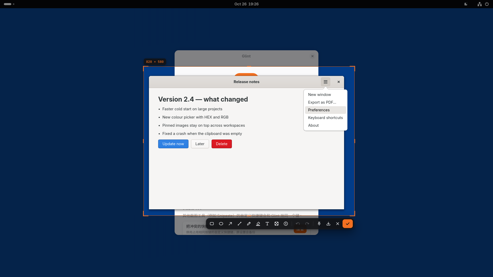
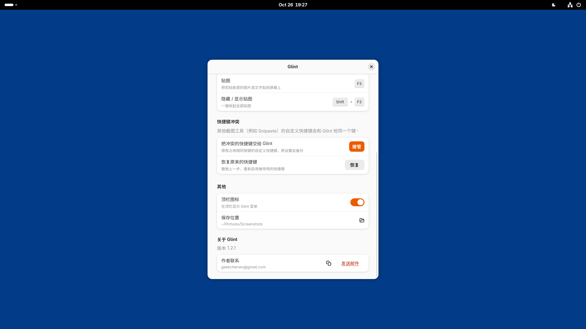

<p align="center">
  
</p>

# Glint

面向 GNOME 桌面的截图、标注与贴图工具。按下 F1，框选区域、添加标注，再复制到剪贴板或固定在屏幕上。

Screenshot, annotation and pinning for GNOME, built with Python, GTK 4 and a GNOME Shell extension.

当前版本：**1.2.1**。当前支持 **GNOME Shell 50**，面向 Debian / Ubuntu；需要 **Python 3.12+、GTK 4.14+**。



## 功能

- 截图、选区调整、窗口与菜单识别；原生扩展模式可保留已经展开的菜单和弹窗。
- 矩形、椭圆、箭头、线条、画笔、荧光笔、文字、马赛克和序号标注。
- 放大镜、像素取色、复制到剪贴板、保存图片。
- 将图片或剪贴板文字贴在屏幕上，统一隐藏和显示贴图。
- 橙色选区和简洁的裁切框 Logo；设置内提供作者联系方式。
- 首次安装可通过系统截图门户直接使用，原生扩展增强功能在下次正常登录后加载。

## 构建与安装

在 GNOME Shell 50 的 Debian / Ubuntu 环境安装构建所需依赖：

```sh
sudo apt install python3 python3-gi python3-gi-cairo python3-cairo \
  gir1.2-rsvg-2.0 dpkg-dev
git clone https://github.com/geekchenwu/glint.git
cd glint
bash packaging/build-deb.sh
```

构建生成 `dist/Glint-1.2.1.run` 和 `dist/glint_1.2.1_all.deb`。
运行安装器时使用普通桌面用户，不要直接以 root 启动图形应用：

```sh
sh dist/Glint-1.2.1.run
```

安装器校验内嵌安装包，并通过 APT 自动安装运行依赖，包括 `python3-gi-cairo`。
缺失依赖需要联网并使用有效的 APT 软件源。

也可以安装 Debian 包：

```sh
sudo apt install ./dist/glint_1.2.1_all.deb
glint activate
```

首次安装后无需立即注销即可截图：如果 GNOME 尚未加载扩展，Glint 会使用系统截图门户，首次使用时请允许系统截图请求。
顶栏菜单、窗口识别、保留展开菜单和贴图置顶等原生能力会在下次正常登录后生效。
升级扩展同样受 GNOME 会话缓存限制。完整说明见 [安装指南](packaging/INSTALL.md)。

## 快捷键

| 快捷键 | 功能 |
| --- | --- |
| F1 | 截图并标注 |
| Ctrl + F1 | 截图后直接复制 |
| F3 | 贴出剪贴板中的图片或文字 |
| Shift + F3 | 隐藏 / 显示全部贴图 |

已有快捷键冲突会保留并提示，可在设置里选择接管。恢复原来的快捷键：

```sh
glint hotkeys restore
```

## 开发

- `app/glint_app/`：GTK 编辑器、贴图、剪贴板和首次启动逻辑。
- `extension/glint@chenwu.local/`：GNOME Shell 截图后端、快捷键、顶栏菜单与设置。
- `data/`、`fonts/`：图标、桌面集成和字体。
- `packaging/`、`tools/`：Debian 打包、单文件安装器和图标生成。
- `dev/`：单元测试、隔离 GNOME 会话与端到端回归工具。

在满足应用运行依赖的环境执行单元测试：

```sh
PYTHONPATH=app /usr/bin/python3 -m unittest discover -s dev -p 'test_*.py'
```

开发用的当前用户安装：

```sh
bash install.sh
```

该脚本安装到 `~/.local/share`，不会自动安装系统依赖。
隔离桌面测试的用法见 `dev/headless.sh`、`dev/regression.py` 和 `dev/first-install.py` 文件头说明。

## 联系作者

**chenwu** · [geekchenwu@gmail.com](mailto:geekchenwu@gmail.com)



## 许可证

应用代码遵循 **GPL-3.0-or-later**，全文见 [LICENSE](LICENSE)。
随附的 Space Grotesk 和 JetBrains Mono 字体遵循 **SIL Open Font License 1.1**，见 [fonts/OFL.txt](fonts/OFL.txt) 与 [版权说明](packaging/copyright)。
