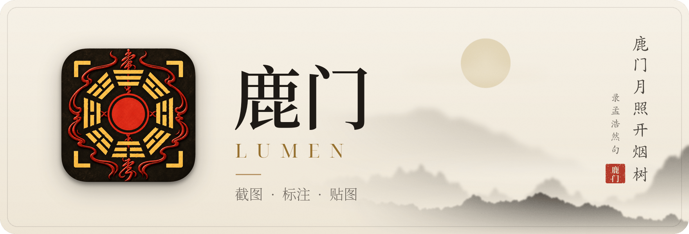
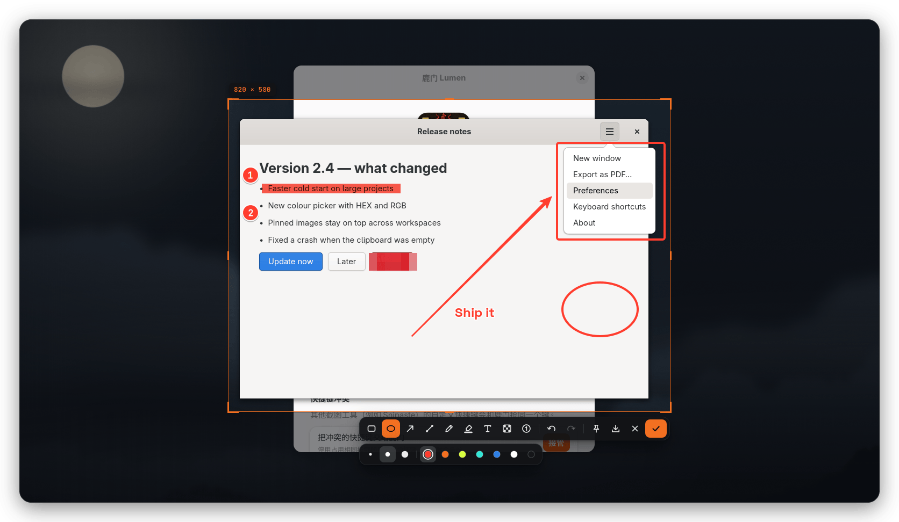
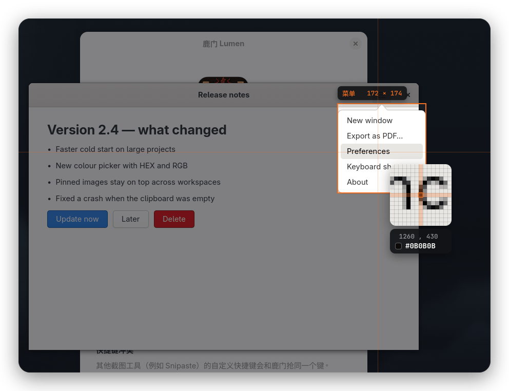
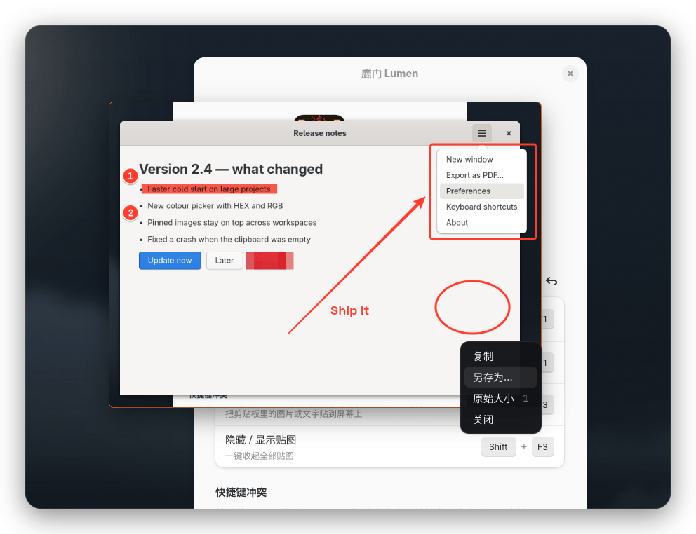

<div align="center">

<p>
  <picture>
    <source media="(prefers-color-scheme: dark)" srcset="screenshots/hero-dark.png">
    
  </picture>
</p>

<br>**在 GNOME Shell 内部完成截图：菜单与弹窗原样入镜，框选、标注、贴图一气呵成。**<br>
<sub>Screenshot, annotate and pin, right inside GNOME Shell. Open menus and popups stay in the shot.</sub>

<br>

[](https://github.com/geekchenwu/lumen/releases/latest)
[](#安装)
[](#安装)
[](LICENSE)

**[下载](https://github.com/geekchenwu/lumen/releases/latest)** &nbsp;·&nbsp; [功能](#功能) &nbsp;·&nbsp; [安装](#安装) &nbsp;·&nbsp; [快捷键](#快捷键) &nbsp;·&nbsp; [名字由来](#名字由来) &nbsp;·&nbsp; [English](#english)

</div>

<br>

<p align="center">
  
</p>

## 功能

<table>
  <tr>
    <td width="50%"></td>
    <td width="50%"></td>
  </tr>
  <tr>
    <td><b>菜单、弹窗也截得到</b><br><sub>截图在 Shell 内部完成，按下 F1 时已展开的菜单原样入镜；悬停即识别窗口与控件，放大镜逐像素取色。</sub></td>
    <td><b>贴在屏幕上</b><br><sub>标注完按 Ctrl+T 贴到屏幕，始终置顶、跨工作区；滚轮缩放，Ctrl+滚轮调不透明度，双击关闭。</sub></td>
  </tr>
</table>

- **九种标注**：矩形、椭圆、箭头、直线、画笔、荧光笔、文字、马赛克、序号，单键切换，随时撤销重做。
- **像素级选区**：拖拽框选或单击选中窗口；方向键 / WASD 逐像素微调，<kbd>R</kbd> 找回上次选区。
- **取色**：放大镜显示坐标与颜色，<kbd>C</kbd> 复制色值，<kbd>Shift</kbd> 切换 HEX / RGB。
- **一键输出**：<kbd>Enter</kbd> 复制，<kbd>Ctrl</kbd> <kbd>S</kbd> 保存，<kbd>Ctrl</kbd> <kbd>T</kbd> 贴图。
- **剪贴板贴图**：<kbd>F3</kbd> 把剪贴板里的图片或文字贴出来，<kbd>Shift</kbd> <kbd>F3</kbd> 一键收起全部贴图。
- **不等待**：屏幕一冻结就进入框选，无损编码在后台进行。
- **装好即用**：扩展尚未加载时自动借用系统截图门户，下次登录后启用全部原生能力。

## 安装

从 [Releases](https://github.com/geekchenwu/lumen/releases/latest) 下载，二选一：

```sh
# 单文件安装器：校验内嵌的安装包，用 APT 补齐依赖
sh Lumen-1.4.0.run

# 或者 Debian 包
sudo apt install ./lumen_1.4.0_all.deb
lumen activate
```

以普通桌面用户运行安装器，不要用 root 启动图形应用。

装好就能截图：GNOME 还没加载扩展时，鹿门会先借用系统截图门户，首次使用请允许系统的截图请求。顶栏菜单、窗口识别、保留展开的菜单、贴图置顶等原生能力，在下次注销并重新登录后生效，升级扩展也一样。完整说明见 [安装指南](packaging/INSTALL.md)。

**环境**：GNOME Shell 50 · Debian / Ubuntu · Python 3.12+ · GTK 4.14+

## 快捷键


| 按键 | 作用 |
| :-- | :-- |
| <kbd>F1</kbd> | 截图并标注 |
| <kbd>Ctrl</kbd> <kbd>F1</kbd> | 截图后直接复制 |
| <kbd>F3</kbd> | 贴出剪贴板里的图片或文字 |
| <kbd>Shift</kbd> <kbd>F3</kbd> | 隐藏 / 显示全部贴图 |

和其他截图工具（例如 Snipaste）抢同一个键时，鹿门不会擅自覆盖：冲突会保留并提示，可在设置里一键接管，原设置自动备份。恢复原来的快捷键：

```sh
lumen hotkeys restore
```

<br clear="right">

<details>
<summary><b>框选、编辑与贴图的全部按键</b></summary>
<br>

| 框选时 | |
| :-- | :-- |
| 拖拽 · 单击 | 框选区域 · 选中窗口或控件 |
| <kbd>W</kbd> <kbd>A</kbd> <kbd>S</kbd> <kbd>D</kbd> · 方向键 | 光标逐像素移动 |
| <kbd>C</kbd> · <kbd>Shift</kbd> | 复制色值 · 切换 HEX / RGB |
| <kbd>R</kbd> | 找回上次选区 |
| <kbd>Ctrl</kbd> <kbd>A</kbd> | 选中全屏 |
| <kbd>Enter</kbd> | 复制悬停中的窗口或控件 |
| <kbd>Esc</kbd> · 右键 | 退出 |

| 选区确定后 | |
| :-- | :-- |
| <kbd>R</kbd> <kbd>E</kbd> <kbd>A</kbd> <kbd>L</kbd> <kbd>P</kbd> <kbd>M</kbd> <kbd>T</kbd> <kbd>X</kbd> <kbd>N</kbd> | 矩形 · 椭圆 · 箭头 · 直线 · 画笔 · 荧光笔 · 文字 · 马赛克 · 序号 |
| <kbd>[</kbd> <kbd>]</kbd> · 滚轮 | 调整当前工具的粗细或字号 |
| 方向键 | 移动选区；加 <kbd>Ctrl</kbd> 向外扩边，加 <kbd>Shift</kbd> 向内收边 |
| <kbd>Space</kbd> | 隐藏 / 显示工具栏 |
| <kbd>Ctrl</kbd> <kbd>Z</kbd> · <kbd>Ctrl</kbd> <kbd>Y</kbd> | 撤销 · 重做（也可用 <kbd>Ctrl</kbd> <kbd>Shift</kbd> <kbd>Z</kbd>） |
| <kbd>Enter</kbd> · <kbd>Ctrl</kbd> <kbd>C</kbd> · 双击选区 | 复制到剪贴板 |
| <kbd>Ctrl</kbd> <kbd>S</kbd> · <kbd>Ctrl</kbd> <kbd>Shift</kbd> <kbd>S</kbd> | 保存 · 另存为 |
| <kbd>Ctrl</kbd> <kbd>T</kbd> | 贴到屏幕 |
| 右键 | 逐级后退：收起工具 → 重新框选 → 退出 |
| <kbd>Esc</kbd> | 退出 |

| 贴图 | |
| :-- | :-- |
| 拖动 · 双击 | 移动 · 关闭 |
| 滚轮 · <kbd>Ctrl</kbd> + 滚轮 | 缩放 · 不透明度 |
| <kbd>1</kbd> | 原始大小 |
| <kbd>Ctrl</kbd> <kbd>C</kbd> · <kbd>Ctrl</kbd> <kbd>S</kbd> | 复制 · 另存为 |
| <kbd>Esc</kbd> · <kbd>Ctrl</kbd> <kbd>W</kbd> | 关闭 |
| 右键 | 复制、另存为、原始大小、关闭 |

</details>

## 名字由来

> 鹿门月照开烟树，忽到庞公栖隐处。
>
> <sub>孟浩然《夜归鹿门歌》</sub>

鹿门山在襄阳。东汉庞德公携妻子登山采药，从此不返；后来孟浩然也归隐于此。诗里，月光照开烟树，隐者的居处便忽然现在眼前。截图也是如此：一束光落下，此刻就被框住。

**Lumen** 在拉丁语里是「光」，也指透光的「开口」与「窗」。鹿门与 Lumen，音近而义通：一扇门，一束光。图标取八卦之形，符文环绕，四角是取景框，正中一点朱红。

## 开发

<details>
<summary><b>从源码构建、测试与目录结构</b></summary>
<br>

在 GNOME Shell 50 的 Debian / Ubuntu 上：

```sh
sudo apt install python3 python3-gi python3-gi-cairo python3-cairo \
  gir1.2-rsvg-2.0 dpkg-dev
git clone https://github.com/geekchenwu/lumen.git
cd lumen
bash packaging/build-deb.sh   # 生成 dist/Lumen-1.4.0.run 与 dist/lumen_1.4.0_all.deb
```

单元测试：

```sh
PYTHONPATH=app /usr/bin/python3 -m unittest discover -s dev -p 'test_*.py'
```

开发用的当前用户安装（装到 `~/.local/share`，不安装系统依赖）：

```sh
bash install.sh
```

| 目录 | 内容 |
| :-- | :-- |
| `app/lumen_app/` | GTK 编辑器、贴图、剪贴板与首次启动逻辑 |
| `extension/lumen@chenwu.local/` | GNOME Shell 截图后端、快捷键、顶栏菜单与设置 |
| `data/` · `fonts/` | 图标、桌面集成与字体 |
| `packaging/` · `tools/` | Debian 打包、单文件安装器与图标生成 |
| `dev/` | 单元测试、隔离 GNOME 会话与端到端回归工具 |

隔离桌面测试的用法见 `dev/headless.sh`、`dev/regression.py` 与 `dev/first-install.py` 的文件头说明。

</details>

## English

**Lumen** (鹿门, *lù mén*) is a screenshot, annotation and pinning tool for GNOME Shell 50 on Debian and Ubuntu.
It captures inside GNOME Shell, so open menus and popups stay in the shot.
Download `Lumen-1.4.0.run` or `lumen_1.4.0_all.deb` from [Releases](https://github.com/geekchenwu/lumen/releases/latest).

<kbd>F1</kbd> capture and annotate · <kbd>Ctrl</kbd> <kbd>F1</kbd> capture to the clipboard ·
<kbd>F3</kbd> pin the clipboard image or text · <kbd>Shift</kbd> <kbd>F3</kbd> hide or show all pins.

The name comes from a line by the Tang poet Meng Haoran, *"moonlight over Deer Gate parts the misty trees"*.
*Lumen* is Latin for light, and for an opening that lets it in.

## 联系作者

**chenwu** · [geekchenwu@gmail.com](mailto:geekchenwu@gmail.com)

## 许可证

应用代码遵循 **GPL-3.0-or-later**，全文见 [LICENSE](LICENSE)。随附的 Space Grotesk 与 JetBrains Mono 字体遵循 **SIL Open Font License 1.1**，见 [fonts/OFL.txt](fonts/OFL.txt) 与 [版权说明](packaging/copyright)。

<br>

<p align="center"><sub>岩扉松径长寂寥，惟有幽人自来去。</sub></p>
